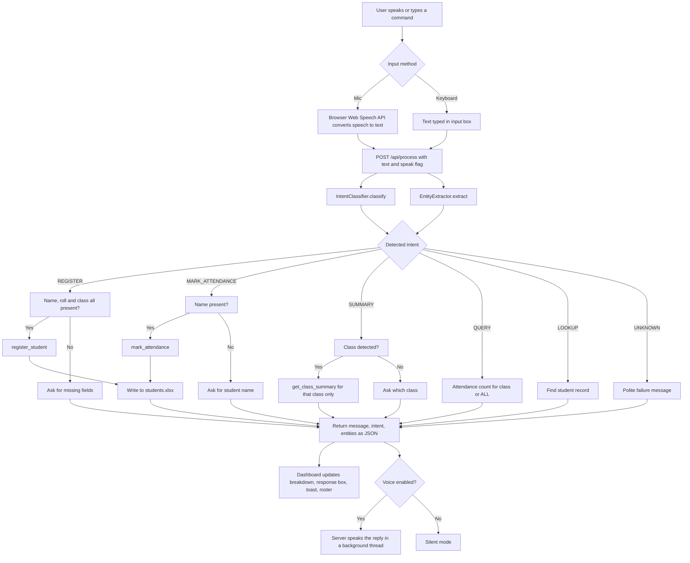
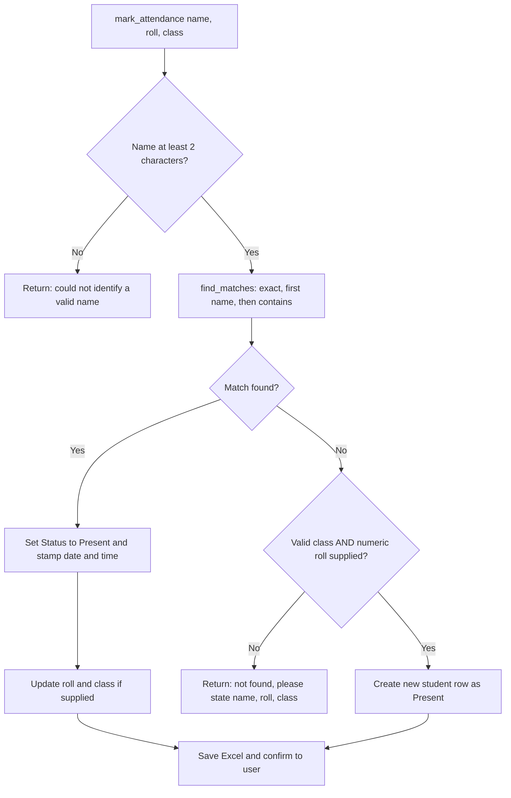

# VoxSheet

**Voice-Activated Student Attendance and Roster Management System**

VoxSheet lets a teacher or class representative mark attendance, register students, and query class summaries by speaking or typing plain English sentences. It runs as a single Python file, serves its own web dashboard, and keeps all records in an Excel file (`students.xlsx`) that can be opened, edited, and exported at any time.

---

## Table of Contents

1. [Overview](#1-overview)
2. [Key Features](#2-key-features)
3. [Technology Stack](#3-technology-stack)
4. [System Architecture](#4-system-architecture)
5. [End-to-End Request Flow](#5-end-to-end-request-flow)
6. [Module-by-Module Explanation](#6-module-by-module-explanation)
7. [Data Model](#7-data-model)
8. [REST API Reference](#8-rest-api-reference)
9. [Web Dashboard Guide](#9-web-dashboard-guide)
10. [Installation and Setup](#10-installation-and-setup)
11. [Usage Guide and Example Commands](#11-usage-guide-and-example-commands)
12. [Design Decisions](#12-design-decisions)
13. [Known Problems and Limitations](#13-known-problems-and-limitations)
14. [Troubleshooting](#14-troubleshooting)
15. [Future Scope and Roadmap](#15-future-scope-and-roadmap)
16. [Expected Outcomes](#16-expected-outcomes)
17. [Project Structure](#17-project-structure)
18. [Author](#19-author-and-license)

---

## 1. Overview

### The problem

Taking attendance manually is slow. Calling out names, writing on paper, and later typing everything into a spreadsheet wastes lecture time and introduces errors. Existing attendance software usually needs forms, logins, and several clicks per student.

### The solution

VoxSheet turns attendance into a one-sentence action:

- Say or type: `mark Rahul Patil present` and the record is updated.
- Say or type: `I am Diksha roll 49 from TE` and the student is registered or marked present.
- Say or type: `summary of TE` and only the TE class summary is returned.

The system understands sentences without requiring the user to choose a mode. It detects what the user wants (the **intent**) and pulls out the relevant details (the **entities**: name, roll number, class) automatically, in any word order.

### Who it is for

- Teachers and class representatives in engineering colleges using the FE / SE / TE / BE year structure.
- Students building NLP, speech, or full-stack projects who want a readable, dependency-light reference implementation.
- Anyone who needs a lightweight attendance tool that stores data in plain Excel.

---

## 2. Key Features

| Feature | Description |
|---|---|
| Natural language understanding | Intent and entities are detected directly from a sentence; no manual mode switching. |
| Voice or text input | Speaking is optional. Every action can be done by typing or clicking. |
| Voice mute and unmute toggle | The header toggle controls whether the system speaks its replies aloud. |
| Class-precise summaries | Asking for TE returns TE only; the same applies to FE, SE, BE, or all classes. |
| Order-independent entity extraction | Hybrid pipeline: explicit phrase patterns, spaCy named entity recognition, regex, and token filtering. |
| Strict data integrity guard | Only valid student records are written to Excel. Questions, commands, and conversation are never saved as students. |
| Excel as the database | Records live in `students.xlsx` with timestamps for each attendance update. |
| Live dashboard | Stat cards, class filter tabs, search, clickable status badges, remove button, and Excel export. |
| Entity breakdown panel | The dashboard shows the detected intent, name, roll number, and class for each command. |
| Zero web framework dependency | The HTTP server is built on Python's standard library, multi-threaded. |
| Thread-safe speech output | Windows SAPI5 with per-thread COM initialization, with a pyttsx3 fallback. |

---

## 3. Technology Stack

| Layer | Technology |
|---|---|
| Language | Python 3.9 or newer |
| Web server | `http.server` and `socketserver.ThreadingTCPServer` (standard library) |
| Frontend | HTML5, CSS3, vanilla JavaScript (no frameworks) |
| Browser speech recognition | Web Speech API (`SpeechRecognition` / `webkitSpeechRecognition`) |
| Server speech recognition | `SpeechRecognition` library with Google Web Speech backend (optional path) |
| Text to speech | Windows SAPI5 via `pywin32`, fallback `pyttsx3` |
| NLP | spaCy (`en_core_web_sm`) plus regular expressions |
| Data handling | pandas |
| Storage | Excel file via `openpyxl` (used by pandas) |
| Fonts | Google Fonts: Plus Jakarta Sans, JetBrains Mono |

---

## 4. System Architecture

The whole application is one file organized into nine clearly separated sections.

```
+---------------------------------------------------------------+
|                      Browser Dashboard                        |
|  Mic button | Text box | Mute toggle | Roster table | Stats   |
|  Web Speech API converts speech to text in the browser        |
+-------------------------------+-------------------------------+
                                | HTTP (JSON)
                                v
+---------------------------------------------------------------+
|        VoxSheetRequestHandler  (ThreadingTCPServer)           |
|  GET  /  /api/roster  /api/summary  /api/download-excel       |
|  POST /api/process /api/voice-record                          |
|       /api/toggle-status /api/delete-student                  |
+-------------------------------+-------------------------------+
                                |
                                v
+---------------------------------------------------------------+
|                 VoxSheetApp (controller)                      |
|                                                               |
|   IntentClassifier  ----+                                     |
|                         +--> process_sentence() --> response  |
|   EntityExtractor   ----+                                     |
|   (spaCy + regex)                                             |
+---------------+-----------------------------+-----------------+
                |                             |
                v                             v
+-------------------------------+   +---------------------------+
|       RosterRepository        |   |       VoiceService        |
|  pandas DataFrame + lock      |   |  speak(): SAPI5/pyttsx3   |
|  find / mark / register /     |   |  listen(): server mic     |
|  toggle / delete / summarize  |   |  (optional)               |
+---------------+---------------+   +---------------------------+
                |
                v
        students.xlsx
   (also mirrored to the parent folder if present)
```

---

## 5. End-to-End Request Flow

### 5.1 Main command flow



### 5.2 Attendance marking decision flow



### 5.3 Name matching order

When searching for a student, the repository tries three strategies in order and stops at the first that returns results:

1. Exact match on the full name (case-insensitive).
2. Match on the first word of the stored name (so `Diksha` matches `Diksha Patil`).
3. Substring match anywhere in the stored name.

If a class is detected in the sentence, the search is first restricted to that class.

---

## 6. Module-by-Module Explanation

### Section 1: Configuration and constants

- `Config` holds the port (`5050`), file paths, allowed classes (`FE, SE, TE, BE`), Excel column names, microphone timeouts, and a built-in default roster of ten sample students used when no Excel file exists.
- `Intent` is an enum of the six intents: `register`, `mark_attendance`, `summary`, `query`, `lookup`, `unknown`.
- `ExtractedEntities` is a small dataclass holding `name`, `roll_no`, and `class_name`, with helpers to check completeness and list missing fields.

### Section 2: VoiceService

- `speak(text)` prints the text to the console, then tries Windows SAPI5 (initializing COM for the current thread, which is required because replies are spoken from background threads). If that fails or the platform is not Windows, it falls back to `pyttsx3`.
- `listen()` captures audio from the server machine's microphone and transcribes it with Google's recognizer. It handles missing devices, timeouts, unclear speech, and network failures separately and returns `None` on any failure.

### Section 3: EntityExtractor

Extracts the three fields from free-form text, regardless of word order.

**Class extraction**
- First checks for words meaning "all" (`all`, `overall`, `entire`, `complete`, `whole`, `every`) and returns `ALL`.
- Then tests patterns for each class, including speech variants: `TE`, `T E`, `T.E.`, `third year`, `3rd year`, and similar for FE (first year, fresher), SE (second year), and BE (final year, fourth year, last year).

**Roll number extraction**
- Tries `roll no 49`, `roll 49`, `number 49`, and finally any standalone number.

**Name extraction** (four stages, first success wins)
1. Self-introduction phrases: `I am ...`, `my name is ...`, `this is ...`.
2. Attendance phrases: `mark ...`, `attendance for ...`.
3. spaCy named entity recognition for `PERSON` entities.
4. Residual token analysis: remove stopwords, command words, class words, and digits, then take the first two remaining words.

Every stage filters out command words (such as `summary`, `help`, `change`, `intent`) so system commands are never mistaken for student names.

### Section 4: IntentClassifier

A keyword-priority classifier. The order matters, because the first matching group wins:

1. Lookup keywords: `what is`, `who is`, `find student`, `lookup`
2. Summary keywords: `summary`, `report`, `overall`, `absent students`, `present students`
3. Query keywords: `how many`, `count`, `headcount`, `attendance of`
4. Mark keywords: `mark`, `present`, `absent`, `is here`, `came to class`
5. Register keywords: `i am`, `my name is`, `register`, `enroll`
6. Fallback: if the sentence has roll, class, or year clues or digits, it is treated as a registration; any other non-empty text defaults to attendance marking.

### Section 5: RosterRepository

The Excel database layer. All write operations are guarded by a `threading.Lock`.

| Method | Purpose |
|---|---|
| `_load` | Loads `students.xlsx` (local first, then parent folder). Cleans roll numbers (removes `.0`), adds a missing `Date` column, strips junk rows. Builds the default roster if no file exists. |
| `_save_df` / `save` | Writes the DataFrame to Excel. Handles the file-open `PermissionError` gracefully. |
| `find_matches` | Three-stage name search with optional class filter. |
| `mark_attendance` | Marks a matched student present; creates a new student only if a valid class and numeric roll are both supplied. |
| `register_student` | Requires name, roll, and class. Updates an existing student, or matches by roll within the class, or creates a new row. |
| `toggle_student_status` | Flips a student between Present and Absent (used by the dashboard badge). |
| `delete_student` | Removes a student, narrowing by roll number when provided. |
| `get_class_summary` | Summary for one specific class, or the overall summary for `ALL`. |
| `get_overall_summary` | One line per class with present, absent, and total counts. |
| `get_attendance_count` | Short sentence form of counts for a class or all classes. |
| `lookup_student` | Returns class, roll number, and status for a named student. |
| `get_roster_data` | Returns the full roster plus overall and per-class statistics for the dashboard. |

### Section 6: VoxSheetApp (controller)

`process_sentence(text)` is the single brain of the system. It classifies the intent, extracts entities, and routes to the correct repository method, returning `(message, intent, entities)`. A module-level singleton, `app_instance`, is shared by all HTTP handler threads.

### Section 7: Web dashboard

A single HTML string served at `/`. It contains the glassmorphism dark theme, animated microphone with soundwave bars, text command box, entity breakdown tags, system response box, four stat cards, class filter tabs, search box, and the roster table. JavaScript polls `/api/roster` every 6 seconds so the table stays live.

### Section 8: HTTP request handler

`VoxSheetRequestHandler` serves the dashboard and implements the REST API using only the standard library (see the API reference below).

### Section 9: Server runner

`start_server()` binds to port 5050, falls back to 5055 if busy, opens the default browser after 1.2 seconds, and serves until interrupted with Ctrl+C.

---

## 7. Data Model

### students.xlsx schema

| Column | Type | Description | Example |
|---|---|---|---|
| Name | text | Student full name, title-cased on creation | `Isha Patil` |
| RollNo | text | Roll number stored as a string | `48` |
| Class | text | One of `FE`, `SE`, `TE`, `BE` | `TE` |
| Status | text | `Present` or `Absent` | `Present` |
| Date | text | Last attendance timestamp, or `-` if never marked | `2026-10-05 09:42` |

### Default roster

If no Excel file is found, ten sample students are created across the four classes, all initially `Absent`. Replace them with your real class list by editing `students.xlsx` or by registering students through the app.

### File location behavior

The app reads and writes `students.xlsx` next to the script. If a `students.xlsx` also exists in the parent directory, it is used as a fallback source and is kept in sync on every save.

---

## 8. REST API Reference

Base URL: `http://localhost:5050` (or `5055` if the first port is busy).

| Method | Endpoint | Body or query | Description |
|---|---|---|---|
| GET | `/` | none | Serves the dashboard page. |
| GET | `/api/roster` | none | Returns `students` array and `stats` (total, present, absent, rate, per-class breakdown). |
| GET | `/api/summary` | `class` (default `TE`), `speak` (`true` or `false`) | Returns the summary for one class or `ALL`; optionally speaks it. |
| GET | `/api/download-excel` | none | Downloads `students.xlsx`. |
| POST | `/api/process` | `{ "text": "...", "speak": true }` | Runs the full NLP pipeline on a sentence. |
| POST | `/api/voice-record` | `{ "speak": true }` | Listens on the server microphone, then processes the transcript. |
| POST | `/api/toggle-status` | `{ "name": "...", "status": "Present" }` | Sets a student's status directly. |
| POST | `/api/delete-student` | `{ "name": "...", "roll_no": "...", "class_name": "..." }` | Removes a student from the roster. |

### Example: process a sentence

Request:

```json
POST /api/process
{ "text": "mark Rahul Patil present", "speak": false }
```

Response:

```json
{
  "success": true,
  "message": "Thank you Rahul Patil! You are marked present for class FE (Roll No: 5).",
  "intent": "mark_attendance",
  "entities": { "name": "Rahul Patil", "roll_no": null, "class": null }
}
```

---

## 9. Web Dashboard Guide

| Area | What it does |
|---|---|
| Voice toggle (header) | Switches spoken replies on or off. Commands and results still appear on screen when muted. |
| Summary Report button | Fetches the summary for the class tab currently selected (or all classes). |
| Export Excel button | Downloads the current `students.xlsx`. |
| Microphone button | Starts browser speech recognition; the transcript is processed automatically. |
| Command text box | Type any natural command and press Enter or click Send. |
| NLP entity panel | Shows the detected intent, name, roll number, and class for the last command. |
| System response box | Shows the full reply, including multi-line summaries. |
| Stat cards | Total enrolled, present, absent, and attendance rate. |
| Class tabs and search | Filter the roster by class and by name or roll number. |
| Status badge | Click to toggle a student between Present and Absent. |
| Remove button | Deletes a student after a confirmation dialog. |

---

## 10. Installation and Setup

### Prerequisites

- Python 3.9 or newer
- A modern browser (Chrome or Edge recommended for voice input)
- Internet connection for browser speech recognition, Google Fonts, and the first-time spaCy model download

### Steps

```bash
# 1. Clone the repository
git clone https://github.com/ayush99-ai/voxsheet.git
cd voxsheet

# 2. Create and activate a virtual environment
python -m venv venv
# Windows
venv\Scripts\activate
# macOS / Linux
source venv/bin/activate

# 3. Install required packages
pip install pandas openpyxl SpeechRecognition spacy

# 4. Download the spaCy English model
python -m spacy download en_core_web_sm

# 5. (Optional) Text to speech
pip install pyttsx3
# Windows only, for SAPI5:
pip install pywin32

# 6. (Optional) Server-side microphone support
pip install pyaudio

# 7. Run the application
python voxsheet.py
```

Replace `voxsheet.py` with whatever you named the file. The dashboard opens automatically at `http://localhost:5050`.

### Suggested requirements.txt

```
pandas
openpyxl
SpeechRecognition
spacy
pyttsx3
pywin32; sys_platform == "win32"
pyaudio
```

### Dependency notes

| Package | Required? | Why |
|---|---|---|
| pandas, openpyxl | Yes | Reading and writing `students.xlsx`. |
| spacy and `en_core_web_sm` | Yes | `spacy` is imported at startup. The model is downloaded automatically on first run if missing. |
| SpeechRecognition | Yes | Imported at startup; used by the server microphone path. |
| pyttsx3 | Optional | Spoken replies on non-Windows systems or if SAPI5 fails. |
| pywin32 | Optional | Preferred spoken replies on Windows. |
| pyaudio | Optional | Only needed for the `/api/voice-record` server microphone endpoint. |

---

## 11. Usage Guide and Example Commands

### Marking attendance

| Say or type | Result |
|---|---|
| `mark Diksha present` | Diksha is marked present with a timestamp. |
| `mark Rahul Patil present` | Rahul Patil (FE) is marked present. |
| `attendance for Neha` | Neha Kulkarni is marked present. |
| `Isha Patil present` | Isha Patil is marked present. |

### Registering or self-registering

| Say or type | Result |
|---|---|
| `I am Diksha roll 49 from TE` | Matches or creates the student and marks present. |
| `my name is Aarav roll number 20 class SE` | Same flow with different phrasing. |
| `Priya 15 BE` | Detected as registration because of the digit and class clue. |

A new student is created only if the name, a numeric roll number, and a valid class are all present.

### Summaries and counts

| Say or type | Result |
|---|---|
| `summary of TE` | TE class only: totals, present list, absent list. |
| `summary of fe` | FE class only. |
| `overall summary` | One line per class. |
| `summary` | The system asks which class you want. |
| `how many present in SE` | Count sentence for SE. |
| `count` | Count across all classes. |

### Lookups

| Say or type | Result |
|---|---|
| `who is Shreya` | Class, roll number, and current status. |
| `find student Siddharth` | Same. |

### Sample summary output

```
Class TE Attendance Summary:
Total Enrolled: 4 | Present: 2 | Absent: 2
Present Students: Diksha (Roll 49), Isha Patil (Roll 48)
Absent Students: Ayush Sharma (Roll 34), Shreya Deshmukh (Roll 12)
```

---

## 12. Design Decisions

| Decision | Reason |
|---|---|
| Single file | Easy to share, submit, and deploy; no package structure to explain. |
| Standard library HTTP server | No Flask or FastAPI dependency; the project stays small and portable. |
| Excel as storage | Teachers already know Excel and can edit or archive records without any tooling. |
| Hybrid NLP (rules plus spaCy) | Rules handle predictable phrases reliably and cheaply; spaCy covers names the rules miss. |
| Priority-based intent keywords | Transparent, debuggable behavior without needing training data. |
| Strict write guard | Prevents queries, commands, and speech errors from polluting the roster with fake students. |
| Browser speech recognition | Works on the user's own microphone, even when the server runs on another machine. |
| Lock around writes | Multiple request threads can run at once; the lock prevents corrupted writes. |
| Voice optional by design | Classrooms can be noisy or quiet; typing must always work. |

---

## 13. Known Problems and Limitations

This section is deliberately thorough. These are real limitations of the current code, listed with their effect and a suggested fix.

### 13.1 Functional limitations

| # | Problem | Effect | Suggested fix |
|---|---|---|---|
| 1 | Voice or text commands can only mark a student **Present**. `mark X absent` still sets Present. | Absence can only be set from the dashboard badge. | Detect `absent` in the sentence and pass a status argument to `mark_attendance`. |
| 2 | One `Status` and one `Date` per student, overwritten on each update. | There is no attendance history; "Absent today" never resets at midnight. | Store one row per student per date or per lecture in a separate attendance log. |
| 3 | The word `be` is a valid class pattern (`BE`). | A sentence like `Rahul will be present` may be read as class BE. | Require word boundaries with context (for example `class BE`, `BE class`), or ignore it when used as a verb via spaCy POS tags. |
| 4 | Words such as `first`, `second`, `third`, `every`, `complete`, `whole` map to classes or ALL. | Ordinary sentences can trigger the wrong class or an overall summary. | Match ordinals only when followed by `year`. |
| 5 | The last roll-number pattern accepts any standalone number. | Stray numbers in a sentence become a roll number. | Remove the bare-number pattern or require a roll cue word. |
| 6 | Intent fallback treats any unrecognized text as attendance marking. | Gibberish is processed as a student name attempt (the write guard blocks bad inserts but the reply can be confusing). | Return `UNKNOWN` unless a name can be confirmed against the roster. |
| 7 | Substring name matching (`contains`). | Short names may match the wrong student. | Add fuzzy scoring and ask for confirmation when multiple students match. |
| 8 | Duplicate first names are not disambiguated. | Two students named `Rahul` resolve to the first one found. | List candidates and ask for roll number. |
| 9 | Intent keywords are English only. | Hindi, Marathi, or mixed-language commands fail. | Add multilingual speech recognition and a multilingual NLP model. |
| 10 | `MAX_DIALOG_RETRIES` is defined in `Config` but never used. | Dead configuration; no multi-turn follow-up (for example, asking for a missing roll number and waiting for the answer). | Implement a conversation state or remove the constant. |

### 13.2 Technical limitations

| # | Problem | Effect | Suggested fix |
|---|---|---|---|
| 1 | `import spacy` sits outside the `try` block in `_init_nlp`. | If spaCy is not installed, the app crashes at startup; the "regex-only fallback" only covers model-loading failure. | Wrap the import in the `try` block so the fallback truly works. |
| 2 | The dashboard defines `triggerServerMic()` but nothing calls it, so `/api/voice-record` is unused by the UI. | Dead code and an extra untested path. | Wire it to a button as a fallback for browsers without Web Speech API, or remove it. |
| 3 | Spoken replies play on the **server** machine, not in the user's browser. | When the app is hosted remotely, the user hears nothing. | Use the browser `speechSynthesis` API for replies. |
| 4 | `RosterRepository` reads (`lookup_student`, `get_roster_data`, summaries) are not locked. | Rare inconsistent reads during a concurrent write. | Use a reentrant lock around reads, or copy the DataFrame under lock. |
| 5 | If `students.xlsx` is open in Excel, saving raises `PermissionError`. | The change exists in memory only and is lost on restart; the user sees a success message regardless. | Return a failure message and retry, or write to a temp file and replace. |
| 6 | The roster is also written to a `students.xlsx` in the parent directory if one exists. | Surprising side effect; can overwrite an unrelated file. | Make the mirror location an explicit setting, off by default. |
| 7 | The dashboard polls `/api/roster` every 6 seconds from every open tab. | Unnecessary load as the roster grows. | Use server-sent events or WebSockets, or poll only after changes. |
| 8 | Port fallback is hard-coded to 5055. | Fails if both ports are busy. | Try a range of ports or accept a command-line argument. |
| 9 | The Excel read and rewrite happens in full on every change. | Slow with thousands of rows; risk of corruption on crash mid-write. | Move to SQLite and export to Excel on demand. |
| 10 | Browser speech recognition needs Chrome or Edge and an internet connection. | Does not work offline or in Firefox. | Add an offline engine such as Vosk or Whisper. |
| 11 | Google Fonts are loaded from the internet. | Fonts fall back to the system default when offline. | Bundle the fonts locally. |

### 13.3 Security limitations

These matter before the app is used anywhere other than a single personal machine.

| # | Problem | Effect | Suggested fix |
|---|---|---|---|
| 1 | The server binds to all network interfaces (`""`). | Anyone on the same network can open the dashboard, change attendance, and delete students. | Bind to `127.0.0.1` by default; add authentication before exposing it. |
| 2 | There is no authentication or role separation. | Any student with network access could mark themselves present. | Add teacher login and per-session tokens. |
| 3 | `Access-Control-Allow-Origin: *` is set on JSON responses. | Any website opened in the same browser can call the API. | Restrict to the app's own origin. |
| 4 | The roster table is built with `innerHTML` and student names are not HTML-escaped. | A student name containing HTML or script could execute in the dashboard (cross-site scripting). | Escape all inserted text or build elements with `textContent`. |
| 5 | Delete and toggle endpoints identify students by name text. | Names containing quotes or duplicates can act on the wrong row. | Use a unique student ID for all actions. |
| 6 | No audit trail for deletions. | A removed student cannot be recovered. | Soft delete with an audit log. |

### 13.4 Accuracy and privacy considerations

- Speech recognition is imperfect with Indian names and accents; always check the response text before relying on a voice-marked record.
- The server microphone path and browser speech recognition both send audio to Google's service, which is a privacy consideration for student data.
- Anyone able to open the dashboard can see student names and attendance status. Treat the Excel file as personal data and follow your institution's data policy.

---

## 14. Troubleshooting

| Symptom | Likely cause | Fix |
|---|---|---|
| App crashes at startup with `ModuleNotFoundError: spacy` | spaCy not installed | `pip install spacy` and download `en_core_web_sm`. |
| Message about downloading the spaCy model | Model missing | Allow the first-run download or run `python -m spacy download en_core_web_sm`. |
| Microphone button says speech is unsupported | Browser lacks Web Speech API | Use Chrome or Edge, or type the command. |
| Toast says the mic needs internet | Browser recognition uses an online service | Connect to the internet or type the command. |
| No speech detected | Mic permission blocked or muted | Allow microphone permission for `localhost` in the browser. |
| Replies are not spoken | Voice toggle muted, or TTS package missing | Check the toggle; install `pyttsx3` or `pywin32`. |
| Console warning: could not save Excel file | `students.xlsx` open in Excel | Close the file in Excel and repeat the action. |
| Dashboard opens on port 5055 | Port 5050 was busy | Use the printed URL, or free port 5050. |
| Wrong student marked | Name matched by first name or substring | Include roll number and class in the command. |
| `summary` asks which class | No class detected | Say `summary of TE` or `overall summary`. |
| Server microphone error mentions PyAudio | PyAudio not installed | `pip install pyaudio` or use the browser microphone. |

---

## 15. Future Scope and Roadmap

### Phase 1: Stabilize (short term)

- Voice and text commands that can mark **absent** and **late**.
- Wrap the spaCy import so the regex-only fallback genuinely works.
- Escape all dashboard output and bind to localhost by default.
- Unique student IDs for all actions.
- Remove or wire up unused code (`triggerServerMic`, `MAX_DIALOG_RETRIES`).
- Unit tests for the intent classifier and entity extractor with a sentence test suite.

### Phase 2: Real attendance tracking (medium term)

- Attendance log table with date, lecture, subject, and teacher, replacing the single status column.
- Automatic daily reset and per-date views.
- Monthly attendance percentage per student with low-attendance warnings.
- SQLite database with Excel and CSV import and export.
- Multi-turn dialog: if a roll number is missing, ask for it and continue.
- Fuzzy name matching with confirmation when multiple students match.
- Teacher login, roles, and per-class permissions.
- Browser text to speech so replies play on the user's device.

### Phase 3: Smarter and more inclusive (long term)

- Hindi, Marathi, and mixed-language voice commands.
- Offline speech recognition (Vosk or Whisper) for classrooms without internet.
- Voice biometrics or a PIN to prevent proxy attendance.
- Analytics dashboard: trends by class, subject, and day of week; defaulter lists.
- Report generation as PDF and scheduled email to parents or the department.
- Notifications to students and parents (email, SMS, or WhatsApp) for absence.
- Docker image and one-command deployment.
- Progressive web app for mobile use.

### Phase 4: Platform vision

- Multi-college, multi-department support with configurable class structures beyond FE/SE/TE/BE.
- Integration with institutional ERP or learning management systems.
- Optional face recognition or QR code check-in as an alternative to voice.
- A language-model-based intent layer for fully open-ended commands, with the rule-based system retained as an offline fallback.

---

## 16. Expected Outcomes

### For teachers

- Attendance for a class can be recorded in a fraction of the time of a paper register.
- Instant class summaries by voice or text, with no manual counting.
- A clean Excel file always available for audits, backups, and sharing.

### For students and the institution

- Fewer transcription errors between paper registers and spreadsheets.
- A foundation for attendance analytics and early identification of irregular students once history tracking is added.

### For the developer

- A complete, readable example of combining speech input, natural language processing, a REST API, a live dashboard, and a spreadsheet database in one project.
- Demonstrates practical skills in Python, NLP with spaCy, pandas, threading, HTTP servers, and frontend development.

### Honest status

VoxSheet in its current form is a strong working prototype and a good fit for a single-machine classroom demo, a mini project, or a portfolio. To be used for real, institution-wide attendance, the security items in Section 13.3 and the history tracking in Phase 2 should be completed first.

---

## 17. Project Structure

```
voxsheet/
|-- voxsheet.py        Main application (all nine sections in one file)
|-- students.xlsx      Roster database (auto-created on first run)
|-- requirements.txt   Python dependencies
|-- README.md          This document
```

Internal layout of the main file:

```
1. Configuration and constants    Config, Intent, ExtractedEntities
2. VoiceService                   speak(), listen()
3. EntityExtractor                class, roll, name extraction
4. IntentClassifier               keyword-priority intent detection
5. RosterRepository               Excel database layer
6. VoxSheetApp                    process_sentence() controller
7. Web dashboard                  HTML, CSS, JavaScript string
8. VoxSheetRequestHandler         REST API and page serving
9. Server runner                  start_server() and entry point
```

## 18. Author
**Diksha Sonar**

VoxSheet is developed as an NLP-based student information management project.
